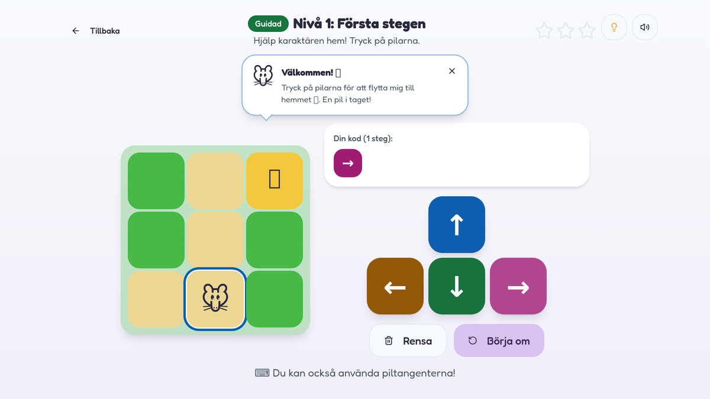

# Kodäventyret

Ett kodspel för de yngsta, ungefär 4–8 år. Barnet väljer en hjälte, går runt på en
äventyrskarta och styr hjälten hem med pilar – först steg för steg, sedan genom att planera
hela koden innan den körs. Det finns också en blockeditor i Scratch-stil.

**Spela:** https://kodaventyret.skolappar.com · En del av [Skolappar](https://www.skolappar.com) – pedagogiska appar av föräldrar · öppen källkod (MIT)



Körs fristående.

## Vad du kan göra

- **Profiler per barn**: flera barn kan dela samma enhet, var och en med namn, hjälte och
  egen progress. Ingen inloggning.
- **Fem hjältar**: mus, prinsessa, bil, katt och robot.
- **Äventyrskarta med 18 banor** i tre lägen:
  - *Guidad* – tryck på pilarna, hjälten går direkt.
  - *Planera* – skriv hela pilkoden först, tryck sedan KÖR.
  - *Mästare* – samla mynt och undvik vatten på vägen hem.
- **Varierade uppdrag**: hämta saker i rätt ordning, välj kortaste vägen, laga kod som saknar
  en pil, har fel pil eller en pil för mycket, och gissa var roboten hamnar.
- **Stjärnor**: upp till tre per bana beroende på hur få steg du använder. Nya banor låses upp
  när du klarar de tidigare.
- **Blockprogrammering**: dra block (START, STOPP, gå upp/ner/vänster/höger, hoppa, upprepa)
  och lägg block inuti en loop.
- Instruktionsbubblor, firande med konfetti och ljudeffekter som kan stängas av.

## Kom igång

```bash
npm install
npm run dev        # utvecklingsserver
npm run build      # produktionsbygge till dist/
npm run build:dev  # bygge i utvecklingsläge
npm run preview    # förhandsgranska bygget
npm run lint       # eslint
```

Docker-bygget använder Node 22.

## Docker

```bash
docker build -t kodaventyret .
docker run --rm -p 8080:8080 kodaventyret
```

Servern ligger bakom nginx med `deploy/nginx.conf`.

## Integritet

- Ingen spårning, inga kakor, ingen analys, inget konto, ingen AI, inga nätverksanrop.
- Typsnittet Fredoka ligger i appen (`public/fonts/`). Ljuden skapas i webbläsaren med
  Web Audio – inga ljudfiler hämtas.
- Allt sparas lokalt i `localStorage`:
  - `kodaventyret-profiles` och `kodaventyret-active-profile` – barnens profiler (namn och hjälte)
  - `kodaventyret-progress-<id>` – stjärnor och upplåsta banor per profil
  - `kodaventyret-tutorials-seen-<id>` – vilka instruktioner som redan visats

  Rensa webbläsardata så är det borta.

## Struktur

```
src/
  pages/Index.tsx           startsida: välj eller skapa profil och hjälte
  pages/AdventureMap.tsx    äventyrskartan med alla banor
  pages/GameLevel.tsx       en bana: rutnät, pilar, kod, kör
  pages/ScratchEditor.tsx   blockprogrammering
  components/game/          rutnät, pilknappar, kodvisning, modaler, instruktioner
  components/scratch/       blockpalett, arbetsyta och scen
  data/levels.ts            de 18 banorna
  hooks/useGameEngine.ts    spelmotor och stjärnor
  hooks/useScratchEngine.ts kör blockprogram
  hooks/useGameProgress.ts  progress i localStorage
  lib/profiles.ts           lokala barnprofiler
deploy/nginx.conf           nginx-konfiguration för Docker
```

## Licens

MIT – se [LICENSE](LICENSE).
